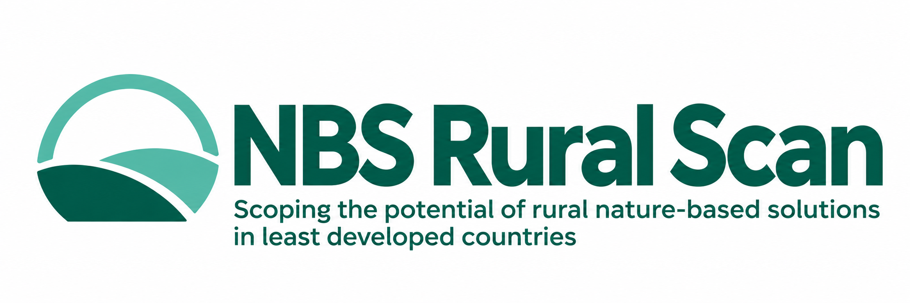

Evidence-based methods and reproducible tools for early investment scoping.

[Start here](https://github.com/RuralScan/method/blob/main/handbook/start-here.md) · [Method](https://github.com/RuralScan/method) · [Evidence](https://github.com/RuralScan/evidence) · [Runtime](https://github.com/RuralScan/runtime)

---

Rural Scan helps World Bank project teams and their partners explore **where nature-based solutions could fit**, **which climate risks matter**, and **who and what could benefit** across agricultural, forestry, and other rural landscapes.

It brings together a shared methodology, traceable evidence, and spatial analysis to support early investment decisions. It is a **scoping tool**: detailed feasibility studies, engineering design, and full cost-benefit analysis follow downstream.

## Find your starting point

| If you want to… | Go to |
| :--- | :--- |
| **Understand the approach** — purpose, concepts, and assessment modules | [Method handbook →](https://github.com/RuralScan/method/blob/main/handbook/start-here.md) |
| **Explore the analytical framework** — definitions, data model, and practice guidance | [Method →](https://github.com/RuralScan/method) |
| **Understand the evidence workflow** — source discovery, extraction, and human review | [Evidence →](https://github.com/RuralScan/evidence) |
| **Run or develop spatial analyses** — Python tools, setup instructions, and notebooks | [Runtime →](https://github.com/RuralScan/runtime) |

## Who this is for

**Project teams and partners** can start with the handbook to understand the questions Rural Scan addresses. **Researchers and reviewers** can follow the evidence workflow and current review guidance. **Analysts and developers** can use the runtime README for installation, examples, and supported analyses.

You can browse the documentation without installing anything. To suggest an improvement or report a problem, open an **Issue** in the relevant repository, linking the page, evidence record, or example concerned.

## Current status

Rural Scan is under development, and this organization is being established. **Method** contains a draft baseline; **Evidence** is a workflow scaffold. Active evidence registration and review remain in [CIAT/nbs_ruralscan](https://github.com/CIAT/nbs_ruralscan) until migration is complete. **Runtime** currently supports a limited agroforestry first pass; see its README for scope and limitations.

---

Developed through a World Bank-funded initiative for rural nature-based solutions.

